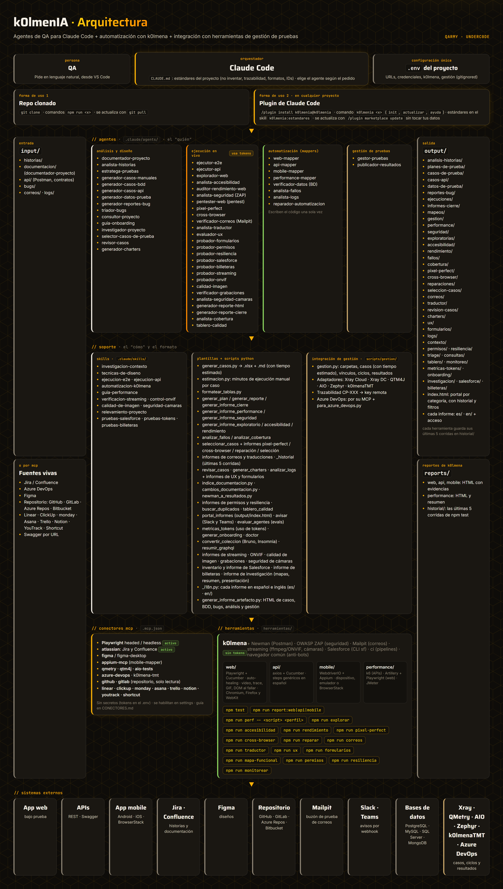
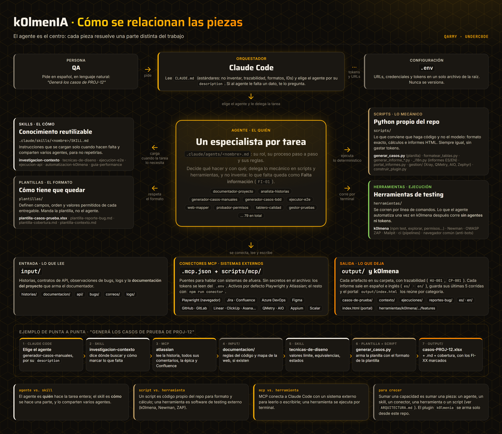
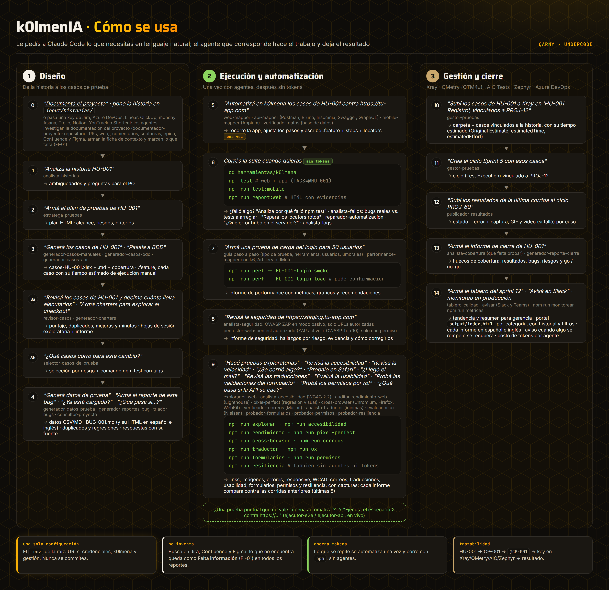

<div align="center">

# 🪖 k0lmenIA

### Agentes de QA para Claude Code

**Diseñá, ejecutá y automatizá pruebas conversando en español.**<br>
Análisis de historias, casos de prueba, automatización con k0lmena y gestión en Xray, QMetry, AIO Tests, Zephyr Scale o Azure DevOps.

<br>

[](#licencia)
[](#)
[](#-agentes)
[](#️-automatización-con-k0lmena)
[](https://docs.claude.com/en/docs/claude-code/overview)

**Automatización**


**Stack**


**Bases de datos**


**Integraciones**


<br>

[**📖 Documentación web**](https://underc0delabs.github.io/k0lmenIA/) · [**📄 Documentación en PDF**](https://github.com/underc0delabs/k0lmenIA/releases/download/docs/k0lmenIA-documentacion.pdf) · [**🇬🇧 English**](https://underc0delabs.github.io/k0lmenIA/en/) ([PDF](docs/k0lmenIA-documentation.pdf)) · [**🚀 Empezar**](#-instalación) · [**🌐 qarmy.ar**](https://qarmy.ar) · [**▶️ YouTube**](https://www.youtube.com/@QARMY-UC?sub_confirmation=1) · [**💬 WhatsApp**](https://whatsapp.com/channel/0029VaSzkgD1CYoTmiX8Uv26)

</div>

---

## ✨ Qué ofrece

> Pensado para QAs manuales: no hace falta programar. Se trabaja conversando con Claude Code dentro de VS Code.

|                                       |                                                                                                                                                                                       |
| ------------------------------------- | ------------------------------------------------------------------------------------------------------------------------------------------------------------------------------------- |
| 🧠 **Diseño de pruebas**              | Analiza historias, arma el plan, escribe casos manuales (Excel), BDD (Gherkin) y de API, genera datos y redacta bugs.                                                                 |
| 🤖 **Automatización sin tokens**      | Los agentes *mapper* recorren tu app **una sola vez** y escriben la automatización en k0lmena. Después corre con `npm test`, sin agentes.                                             |
| 🌐 **Web, API, mobile y performance** | Playwright + Cucumber, axios + Cucumber (REST y GraphQL; colecciones de Postman, Bruno o Insomnia), WebdriverIO + Appium (dispositivo, emulador o BrowserStack), k6, Artillery y JMeter.                                                         |
| 📸 **Evidencia completa**             | Captura (y GIF) de cada test que pasa; video, logs, trace y error de cada test que falla, en reportes HTML.                                                                           |
| 🗂️ **Gestión de pruebas**             | Carpetas, casos, ciclos y resultados con evidencias en **Xray** (Cloud y Server/DC), **QMetry (QTM4J)**, **AIO Tests** y **Zephyr Scale**; casos y suites en **Azure DevOps Test Plans**. |
| 🗄️ **Verificación en base de datos**  | Revisa lo que dejaron guardado tus pruebas en **PostgreSQL, MySQL/MariaDB, SQL Server o MongoDB**, a pedido o, si lo pedís, como steps dentro de los tests. Solo lectura por defecto. |
| 🔌 **Conectado**                      | Lee historias de **Jira**, **Azure DevOps**, **Linear**, **ClickUp**, **monday.com**, **Asana**, **Trello**, **Notion**, **YouTrack** o **Shortcut**, el repositorio de **GitHub, GitLab, Azure Repos o Bitbucket**, documentación de **Confluence** o de la Wiki de Azure DevOps y diseños de **Figma** por MCP.                                            |
| 🔎 **Investiga antes de suponer**     | Lee la historia de Jira con **todos sus comentarios, subtareas, épica e issues vinculados**, más Confluence y Figma, y arma una ficha de contexto.                                    |
| 🛡️ **No inventa**                     | Lo que no está en ninguna fuente queda marcado como **Falta información** (`FI-01`) en todos los reportes, con la pregunta para el PO.                                                |

<p align="center">
  
</p>

<p align="center">
  
</p>

<p align="center">
  
</p>

---

## 📚 Contenido

- [Agentes](#-agentes)
- [Requisitos](#-requisitos)
- [Instalación](#-instalación)
- [Configuración: el archivo `.env`](#️-configuración-el-archivo-env)
- [Cómo se usa](#-cómo-se-usa)
- [Investigación de contexto y "Falta información"](#-investigación-de-contexto-y-falta-información)
- [Documentación del proyecto](#-documentación-del-proyecto)
- [Automatización con k0lmena](#️-automatización-con-k0lmena)
- [Pruebas de performance](#-pruebas-de-performance)
- [Gestión de pruebas: Xray, QMetry, AIO Tests, Zephyr y Azure DevOps](#️-gestión-de-pruebas-xray-qmetry-aio-tests-zephyr-y-azure-devops)
- [k0lmena en el pipeline (CI)](#-k0lmena-en-el-pipeline-ci)
- [Pruebas exploratorias](#-pruebas-exploratorias)
- [Accesibilidad](#-accesibilidad)
- [Rendimiento web](#-rendimiento-web)
- [Análisis de fallos](#-análisis-de-fallos)
- [Cobertura y trazabilidad](#-cobertura-y-trazabilidad)
- [Selección de casos por cambio](#-selección-de-casos-por-cambio)
- [Regresión visual (pixel perfect)](#-regresión-visual-pixel-perfect)
- [Cross-browser](#-cross-browser)
- [Reparación de la automatización](#-reparación-de-la-automatización)
- [Correos](#-correos)
- [Revisión de casos y tiempo de ejecución](#-revisión-de-casos-y-tiempo-de-ejecución)
- [Exploratorias por sesiones](#-exploratorias-por-sesiones)
- [Usabilidad (heurísticas de Nielsen)](#-usabilidad-heurísticas-de-nielsen)
- [Formularios](#-formularios)
- [Permisos por rol](#-permisos-por-rol)
- [Resiliencia](#-resiliencia)
- [Triage de bugs y consultas](#-triage-de-bugs-y-consultas)
- [Logs](#-logs)
- [Traducciones e idiomas](#-traducciones-e-idiomas)
- [Historial de corridas](#-historial-de-corridas)
- [Tablero de calidad y portal de informes](#-tablero-de-calidad-y-portal-de-informes)
- [Avisos y monitoreo sintético](#-avisos-y-monitoreo-sintético)
- [Evals de los agentes](#-evals-de-los-agentes)
- [Uso de tokens](#-uso-de-tokens)
- [Onboarding](#-onboarding)
- [Apps con protección anti-bots](#-apps-con-protección-anti-bots)
- [Seguridad web](#️-seguridad-web)
- [Verificación en base de datos](#️-verificación-en-base-de-datos)
- [Conectores MCP](#-conectores-mcp)
- [Referencia](#-referencia): flujo completo, convenciones, estructura, problemas frecuentes y cómo extenderlo

---

## 🤖 Agentes

Claude Code elige el agente según lo que pidas; también podés nombrarlo (*"usá el web-mapper para…"*). **El catálogo completo** —cuándo usar cada agente, un pedido de ejemplo, qué skills, scripts, herramientas y conectores usa, qué entrega y qué te confirma antes— está en [`AGENTES.md`](AGENTES.md).

<table>
<tr><th>Familia</th><th>Agente</th><th>Qué hace</th></tr>
<tr><td rowspan="15"><b>🧠 Análisis<br>y diseño</b></td>
  <td><code>documentador-proyecto</code></td><td>Arma la documentación del proyecto en <code>input/documentacion/</code>: lee el repositorio (GitHub, GitLab, Azure Repos o Bitbucket, solo lectura), las historias con sus comentarios, PRs y links, y hace un mapa funcional de la web</td></tr>
<tr><td><code>analista-historias</code></td><td>Investiga el contexto (comentarios, subtareas, épica, Confluence, Figma) y detecta ambigüedades, vacíos, riesgos y Falta información</td></tr>
<tr><td><code>estratega-pruebas</code></td><td>Plan de pruebas (alcance, riesgos, tipos, entorno, criterios) en HTML</td></tr>
<tr><td><code>generador-casos-manuales</code></td><td>Casos en Excel y Markdown + informe de cobertura</td></tr>
<tr><td><code>generador-casos-bdd</code></td><td>Escenarios Gherkin (keywords en inglés, contenido en español) + cobertura</td></tr>
<tr><td><code>generador-casos-api</code></td><td>Casos de API positivos, negativos, de schema y autorización</td></tr>
<tr><td><code>generador-datos-prueba</code></td><td>Datos válidos, inválidos y de borde (Markdown o CSV)</td></tr>
<tr><td><code>generador-reportes-bug</code></td><td>Reporte de bug según tu plantilla, con severidad y prioridad justificadas</td></tr>
<tr><td><code>triador-bugs</code></td><td>Antes de cargar un bug, busca si ya existe en Jira, Azure DevOps o los bugs locales, detecta regresiones de bugs cerrados y sugiere severidad, componente, responsable e historia</td></tr>
<tr><td><code>consultor-proyecto</code></td><td>Preguntale cómo funciona cualquier parte del producto: responde con la documentación del proyecto, citando de dónde sale cada dato o diciendo que no está documentado</td></tr>
<tr><td><code>guia-onboarding</code></td><td>Plan de incorporación para un QA nuevo: el producto, su entorno, los agentes para su rol, las primeras tareas y un checklist</td></tr>
<tr><td><code>investigador-proyecto</code></td><td>Releva el proyecto entero por MCP (Jira, Azure DevOps, Confluence, repo, Figma) y arma un informe para un QA nuevo: de qué se trata, módulos, flujos, equipo, ambigüedades y contradicciones con sus fuentes, y preguntas priorizadas para el equipo</td></tr>
<tr><td><code>redactor-manual</code></td><td>Arma el manual de usuario de una funcionalidad, un módulo o toda la plataforma: cruza lo que ya se sabe del proyecto (Jira/Azure DevOps, investigación, mapa funcional, casos) con la app recorrida con Playwright (capturas), marca cada duda para revisión humana y deja lo aprendido en <code>input/documentacion/</code> para que los casos de prueba tengan contexto real.</td></tr>
<tr><td><code>revisor-casos</code></td><td>Revisa la calidad de los casos existentes: puntaje, problemas, duplicados, tiempo de ejecución manual y la versión mejorada</td></tr>
<tr><td><code>generador-charters</code></td><td>Charters de exploración por sesiones (hojas y plantilla de notas) y el informe de las sesiones</td></tr>
<tr><td><code>selector-casos-de-prueba</code></td><td>Qué casos correr para un cambio (git, PR, Jira, notas de la release), priorizados por riesgo, con el comando <code>npm test</code> listo y los cambios sin cobertura</td></tr>
<tr><td rowspan="20"><b>▶️ Ejecución<br>en vivo</b><br><sub>usa tokens</sub></td>
  <td><code>ejecutor-e2e</code></td><td>Ejecuta casos en un navegador real con Playwright MCP, con evidencia</td></tr>
<tr><td><code>ejecutor-api</code></td><td>Corre una colección de Postman, Bruno o Insomnia con Newman (REST y GraphQL)</td></tr>
<tr><td><code>auditor-rendimiento-web</code></td><td>Velocidad de carga con Lighthouse en mobile y desktop: Core Web Vitals, oportunidades de mejora con el ahorro estimado y secuencia de carga</td></tr>
<tr><td><code>analista-accesibilidad</code></td><td>Auditoría WCAG 2.2 (axe-core, teclado, reflow y revisión manual) con informe HTML: criterios incumplidos, capturas y cómo corregir</td></tr>
<tr><td><code>explorador-web</code></td><td>Pruebas exploratorias: links e imágenes rotas, errores de JavaScript y consola, responsive en varias resoluciones, con informe HTML y capturas</td></tr>
<tr><td><code>pixel-perfect</code></td><td>Regresión visual contra una referencia (o el diseño): qué se corrió y cuántos píxeles, qué falta, qué es nuevo y qué cambió de estilo, con comparador deslizable</td></tr>
<tr><td><code>evaluador-ux</code></td><td>Usabilidad con las 10 heurísticas de Nielsen: medición automática en desktop y mobile más la revisión manual de los flujos</td></tr>
<tr><td><code>probador-formularios</code></td><td>Valida cada campo de los formularios sin enviarlos: obligatorios, largos, formatos, límites y mensajes</td></tr>
<tr><td><code>probador-permisos</code></td><td>Inicia sesión con cada rol y arma la matriz de qué ve y qué abre cada uno (también por URL directa y en la API), comparada con la regla documentada</td></tr>
<tr><td><code>probador-resiliencia</code></td><td>Simula que la API falla o tarda, que la red se corta y que no cargan los recursos, y revisa qué ve la persona: pantallas en blanco, errores sin aviso, spinners infinitos, recuperación</td></tr>
<tr><td><code>probador-salesforce</code></td><td>Prueba una org de Salesforce (sandbox): releva acceso (perfiles, permisos, OWD, FLS), validaciones, flows, triggers, cobertura de Apex y límites con la CLI <code>sf</code>, deriva y corre pruebas por perfil en Lightning. Nunca producción; no toca metadata</td></tr>
<tr><td><code>probador-billeteras</code></td><td>Prueba billeteras virtuales y pagos en sandbox: conservación del saldo, idempotencia, doble gasto y concurrencia, límites, KYC/AML, conciliación con la pasarela y seguridad de tokens y tarjetas (PCI). Dinero y tarjetas de prueba, nunca reales</td></tr>
<tr><td><code>probador-shopify</code></td><td>Prueba una tienda Shopify: releva en solo lectura la vidriera (tema, errores de Liquid, políticas, catálogo) y la Admin API (productos y stock, mercados, envíos, descuentos, webhooks) y corre Theme Check; prueba el checkout con Bogus Gateway o el modo de prueba en mobile y desktop</td></tr>
<tr><td><code>probador-wordpress</code></td><td>Prueba WordPress y WooCommerce: releva en solo lectura la vidriera, la REST API de WooCommerce (plugins y templates desactualizados, pasarelas y su modo, envíos, cupones, webhooks, cron) y WP-CLI; prueba checkout, pagos de prueba, envíos, cupones, correos y roles</td></tr>
<tr><td><code>probador-prestashop</code></td><td>Prueba PrestaShop (1.6/1.7/8.x): releva en solo lectura la vidriera y la Webservice API (productos, stock, combinaciones, transportistas, zonas, monedas, vales, multistore y config de rendimiento) y, con --local, versión y modo dev; smoke local, checkout, pagos de prueba, stock, redondeo y rendimiento.</td></tr>
<tr><td><code>probador-vtex</code></td><td>Prueba VTEX: vidriera, Catalog System público (SKUs, precio, stock) y, con app de lectura, canales de venta, SLAs de envío y promociones; smoke en workspace de QA, checkout/orderForm, pagos sandbox, canales, promos y OMS.</td></tr>
<tr><td><code>probador-sap</code></td><td>Prueba SAP (S/4HANA o ECC) en mandante de QA: SAP GUI (T-codes con la Scripting API) y Fiori/UI5 (OData), autorizaciones y roles (PFCG/SU53/SoD) y procesos O2C/P2P/R2R de punta a punta; smoke, regresión tras transporte, rendimiento y seguridad.</td></tr>
<tr><td><code>probador-desktop</code></td><td>Prueba apps de escritorio Windows (WinForms/WPF/UWP/Win32/Electron/Java/Qt): releva el árbol de controles (pywinauto) y prueba con Appium+WinAppDriver, pywinauto o Playwright (Electron); funcional, instalación, archivos, SO, regresión, rendimiento y seguridad.</td></tr>
<tr><td><code>probador-mobile</code></td><td>Prueba apps móviles (Android/iOS; nativa/híbrida/web) en vivo con Appium: permisos, interrupciones, offline, deep links y push, ciclo de vida, compatibilidad de OS y pantallas, rendimiento y seguridad móvil (MASVS).</td></tr>
<tr><td><code>analista-dependencias</code></td><td>SCA de dependencias (solo lectura): corre npm audit / pip-audit / osv-scanner, agrega los CVE por severidad, distingue directas de transitivas y vulnerable de desactualizado, y marca licencias a revisar.</td></tr>
<tr><td><code>revisor-codigo</code></td><td>Code review estático (solo lectura) de un repo, rama o PR/MR de GitHub, GitLab, Bitbucket, Azure Repos o cualquier git: seguridad, performance, confiabilidad, malas prácticas y mantenibilidad (complejidad, duplicados); confirma cada hallazgo, sugiere aprobar o pedir cambios y deja los comentarios listos para pegar en el PR.</td></tr>
<tr><td><code>analista-codigo-seguro</code></td><td>SAST y secretos (solo lectura): escáner de secretos integrado (redacta el valor) + semgrep si está, triage de falsos positivos y mapeo a OWASP/CWE; complementa el análisis dinámico (ZAP).</td></tr>
<tr><td><code>probador-ia</code></td><td>Prueba funciones de IA/LLM (chatbot, RAG, clasificador, agente): golden set y evals, alucinaciones y grounding, seguridad de prompt (injection/jailbreak), formato, robustez, latencia y costo.</td></tr>
<tr><td><code>probador-mensajeria</code></td><td>Prueba mensajería/eventos (Kafka/RabbitMQ/SQS/MQTT/WebSocket/SSE): entrega, orden, idempotencia, DLQ y reintentos, esquemas, consumer lag y outbox; publica/consume con la herramienta.</td></tr>
<tr><td><code>probador-soap</code></td><td>Prueba servicios SOAP desde el WSDL: operaciones, validación XSD, SOAP Faults, namespaces/SOAPAction, WS-Security e idempotencia; envía los sobres con ejecutor-api.</td></tr>
<tr><td><code>probador-scalar</code></td><td>Prueba APIs que están en Scalar: se conecta a su MCP, trae el contrato del Registry, escribe los casos, los corre como colección con tests (Newman, sin gastar tokens) y los importa a Scalar (ejemplos por caso y tests en <code>x-post-response</code>), publicando solo con confirmación.</td></tr>
<tr><td><code>probador-contratos</code></td><td>Contract testing (Pact): consumer-driven y bi-direccional para REST, GraphQL, gRPC y eventos; verificación del proveedor, can-i-deploy y compatibilidad.</td></tr>
<tr><td><code>analista-seo</code></td><td>SEO y GEO: indexabilidad, on-page, datos estructurados, hreflang y acceso de los crawlers de IA; releva con npm run seo y deriva los Core Web Vitals al auditor-rendimiento-web.</td></tr>
<tr><td><code>probador-datos</code></td><td>Datos y pipelines (ETL): calidad por dimensiones, reconciliación origen-destino, validación de esquema, transformaciones e idempotencia; solo lectura con verificador-datos.</td></tr>
<tr><td><code>probador-dynamics</code></td><td>Dynamics 365 y otros CRM/ERP (sandbox): roles, lógica (flows/plugins/BPF/roll-ups) y procesos end-to-end; Web API de lectura + Playwright por rol.</td></tr>
<tr><td><code>probador-blockchain</code></td><td>Blockchain/Web3 y smart contracts (testnet/local): funcional, tokens, gas, seguridad (reentrancy, control de acceso, oráculos, proxies), Hardhat/Foundry e invariantes.</td></tr>
<tr><td><code>probador-ivr</code></td><td>Voz/IVR y voicebots: árbol de menús (DTMF/voz), prompts, enrutamiento y colas, telefonía (SIP/VoIP) y cumplimiento (PCI).</td></tr>
<tr><td><code>probador-juegos</code></td><td>Videojuegos (Unity/Unreal/Godot/HTML5/mobile): mecánicas, guardado, compatibilidad, rendimiento, multijugador, monetización y exploratorias para romper el mundo.</td></tr>
<tr><td><code>probador-pos</code></td><td>Punto de venta (POS) y hardware: venta y arqueo, pagos y periféricos, fiscal, offline y conciliación, cierres de caja.</td></tr>
<tr><td><code>analista-observabilidad</code></td><td>Analiza la observabilidad de un servicio: valida logs (trace id, sin PII), métricas (Prometheus, RED/USE), trazas (OTel), healthchecks (liveness/readiness), SLOs y que las alertas disparen</td></tr>
<tr><td><code>probador-busqueda</code></td><td>Prueba la búsqueda y la relevancia (Elasticsearch/Algolia/Solr/DB): ranking, typos, sinónimos, facetas, indexación y un golden set con métricas (precision@k, nDCG); contra ambientes de QA</td></tr>
<tr><td><code>probador-documentos</code></td><td>Prueba documentos generados (PDF/Excel/CSV): datos y totales, placeholders sin reemplazar, formato/locale, layout, metadata y seguridad; extrae el contenido con pypdf/openpyxl</td></tr>
<tr><td><code>revisor-contenido</code></td><td>Revisa el contenido y los typos en el idioma principal: ortografía, placeholders, claves de i18n a la vista, palabras duplicadas y consistencia de microcopy</td></tr>
<tr><td><code>analista-mutacion</code></td><td>Mide la calidad real de la suite de tests con mutation testing (Stryker/mutmut/PITest): mutation score por archivo, mutantes sobrevivientes vs. equivalentes y qué test falta. Mejor señal que el coverage</td></tr>
<tr><td><code>verificador-correos</code></td><td>Correos de la app con un buzón de prueba (Mailpit): que llegue lo esperado, variables sin reemplazar, links, compatibilidad con Outlook y Gmail, vista desktop y mobile</td></tr>
<tr><td><code>analista-traductor</code></td><td>Cada página en cada idioma: textos sin traducir, claves a la vista, caracteres rotos, textos cortados y formatos de otra región, con la traducción propuesta</td></tr>
<tr><td><code>cross-browser</code></td><td>Chromium (Chrome, Edge), Firefox y WebKit (Safari): la suite por navegador o las páginas comparadas, con lo que falla o se ve distinto en cada uno</td></tr>
<tr><td><code>generador-reporte-html</code></td><td>Dashboard HTML de una ejecución</td></tr>
<tr><td><code>generador-reporte-cierre</code></td><td>Informe de cierre con recomendación go/no-go</td></tr>
<tr><td><code>tablero-calidad</code></td><td>Tablero de calidad por sprint o release: aprobados y tendencia, % automatizado, cobertura, bugs, inestables y resumen para gerencia</td></tr>
<tr><td><code>analista-cobertura</code></td><td>Matriz de trazabilidad (HU → criterios → casos → automatización → resultados) y qué falta probar</td></tr>
<tr><td rowspan="9"><b>⚙️ Automatización<br>k0lmena</b><br><sub>después sin tokens</sub></td>
  <td><code>web-mapper</code></td><td>Recorre la web siguiendo tus casos y genera <code>.feature</code>, steps y locators</td></tr>
<tr><td><code>api-mapper</code></td><td>Lee Postman o Swagger/OpenAPI, verifica los endpoints y genera los <code>.feature</code></td></tr>
<tr><td><code>mobile-mapper</code></td><td>Recorre la app con Appium y genera <code>.feature</code>, steps y locators</td></tr>
<tr><td><code>performance-mapper</code></td><td>Carga, estrés, soak y picos con k6, Artillery o JMeter; pregunta carga y umbrales</td></tr>
<tr><td><code>analista-fallos</code></td><td>Cuando <code>npm test</code> falla: separa bugs reales de tests rotos, inestables, de datos o de ambiente, con la evidencia</td></tr>
<tr><td><code>analista-logs</code></td><td>Logs del servidor agrupados por error y cruzados con los escenarios que fallaron en <code>npm test</code></td></tr>
<tr><td><code>reparador-automatizacion</code></td><td>Repara los locators y esperas que se rompieron: diagnostica con el DOM guardado al fallar, propone un locator único, lo aplica con respaldo y lo verifica</td></tr>
<tr><td><code>verificador-datos</code></td><td>Verifica datos en PostgreSQL, MySQL/MariaDB, SQL Server o MongoDB y suma verificaciones de BD a los tests</td></tr>
<tr><td><code>analista-seguridad</code></td><td>Escaneo de seguridad web pasivo con OWASP ZAP e informe HTML con hallazgos, evidencia y cómo corregirlos</td></tr>
<tr><td><code>pentester-web</code></td><td>Pentest web autorizado (ethical hacking): escaneo activo de OWASP ZAP más verificación manual del OWASP Top 10 con Playwright; confirma cada hallazgo y arma el informe con pasos para reproducir y cómo corregir. Solo URLs autorizadas y con permiso</td></tr>
<tr><td rowspan="2"><b>🗂️ Gestión</b></td>
  <td><code>gestor-pruebas</code></td><td>Carpetas, casos, vínculos con la historia y ciclos en Xray, QMetry, AIO Tests, Zephyr Scale o Azure DevOps</td></tr>
<tr><td><code>publicador-resultados</code></td><td>Sube los resultados de <code>npm test</code> al ciclo con sus evidencias</td></tr>
</table>

---

## 📋 Requisitos

| Para…                     | Necesitás                                                                                                 |
| ------------------------- | --------------------------------------------------------------------------------------------------------- |
| Usar los agentes          | **Claude Code** + cuenta de Claude (Pro, Max, Team o Enterprise) o API de Anthropic. VS Code recomendado. |
| Casos, reportes y gestión | **Python 3.10+** (`pip install -r requirements.txt`; en Mac/Linux, `pip3`)                                |
| Ejecutar E2E en vivo      | **Node.js 20+** (22 LTS recomendado) y navegadores de Playwright                                          |
| Colecciones de Postman    | **Newman**                                                                                                |
| Automatizar con k0lmena   | **Node.js 20+** (22 LTS recomendado; también lo piden los conectores de Azure DevOps y QMetry)            |
| Seguridad web (ZAP)       | **Docker** (Docker Desktop)                                                                               |
| Automatizar mobile        | **Node.js 22+**, JDK y Android SDK (o macOS con Xcode), o BrowserStack                                    |
| Performance con JMeter    | **Java 8+** (`npm run bootstrap:jmeter` descarga JMeter)                                                  |

---

## 🚀 Instalación

```bash
# 1. Claude Code (macOS / Linux; en Windows seguí la guía oficial, abajo)
curl -fsSL https://claude.ai/install.sh | bash

# 2. El repositorio (si ya lo tenés clonado con otro nombre, entrá a esa carpeta)
git clone https://github.com/underc0delabs/k0lmenIA.git
cd k0lmenIA
pip install -r requirements.txt   # en Mac/Linux: pip3 install -r requirements.txt
npm install                       # k0lmena (se instala en herramientas/k0lmena)
npm run configurar                # preguntas simples: tu app y las herramientas de tu equipo (crea el .env y activa los conectores)

# 3. Revisá que esté todo listo
npm run doctor                    # dice qué falta y cómo resolverlo

# 4. A trabajar
code .
claude                            # en la terminal de VS Code
```

> En Windows el comando de Python es `python`; en Mac y Linux, `python3` y `pip3`. Si en Mac `pip3` responde *externally-managed-environment*, usá un entorno virtual: `python3 -m venv .venv && source .venv/bin/activate` (`.venv/` ya está en `.gitignore`).

<details>
<summary><b>Instalar lo opcional</b> (ejecución en vivo, Newman, k0lmena, k6)</summary>

```bash
npx playwright install                  # ejecución E2E en vivo
npm install -g newman                   # colecciones de Postman

npm install                             # k0lmena (desde la raíz; instala en herramientas/k0lmena)
cd herramientas/k0lmena
npx playwright install chromium
npm run bootstrap:k6                    # performance de APIs con k6
npm run bootstrap:jmeter                # performance con JMeter (necesita Java 8+)
```

Claude Code también se instala con `npm install -g @anthropic-ai/claude-code` (con Node.js 22 LTS cubrís Claude Code y todo el proyecto). Guía oficial: https://docs.claude.com/en/docs/claude-code/overview
</details>

---

## ⚙️ Configuración: el archivo `.env`

Hay **un solo `.env`, en la raíz**. Lo usan los agentes, k0lmena y los scripts de gestión. Nunca se sube al repo; la plantilla comentada es [`.env.example`](.env.example).

**La forma fácil:** `npm run configurar`. Pregunta la URL de tu app y qué herramientas usa tu equipo (dónde están las historias, dónde guardan los casos, el código y Figma), pide solo los datos de esas herramientas y activa los conectores. Se puede correr las veces que quieras: Enter deja lo que ya estaba. Lo de abajo es para quien quiera editar el `.env` a mano.

| Grupo                  | Variables                                                                                                                                   |
| ---------------------- | ------------------------------------------------------------------------------------------------------------------------------------------- |
| App bajo prueba        | `APP_URL` `APP_USER` `APP_PASSWORD`                                                                                                         |
| API                    | `API_TOKEN` `API_BASEURL`                                                                                                                   |
| Web (k0lmena)          | `BROWSER` `HEADLESS` `VIEWPORT_WIDTH` `VIEWPORT_HEIGHT` `LOCALE` `TIMEZONE` (la URL es `APP_URL`)                                           |
| Ejecución y evidencias | `TAGS` `PARALLEL` `EVIDENCE` (`captura` · `ambos` · `off`) `VIDEO` `TRACE` `K0LMENA_AUTO_HEALING`                                           |
| Mobile                 | `MOBILE_TARGET` (`device` · `emulator` · `browserstack`) `MOBILE_PLATFORM` `MOBILE_DEVICE_NAME` `MOBILE_APP` `MOBILE_UDID` `BROWSERSTACK_*` |
| Performance            | `PERF_VUS` `PERF_DURACION` (opcionales)                                                                                                     |
| Bases de datos         | `DB_CONEXIONES` + por conexión `DB_<NOMBRE>_MOTOR` `_HOST` `_PUERTO` `_BASE` `_USUARIO` `_CLAVE` (o `_URL`) `_ESCRITURA` `_PRODUCCION`      |
| Gestión                | `GESTION_HERRAMIENTA` `GESTION_PROYECTO` + credenciales de Xray, QTM4J, AIO o Zephyr                                                        |
| Azure DevOps (MCP)     | `ADO_ORGANIZACION` `ADO_PAT` `ADO_PROYECTO`                                                                                                 |

> [!WARNING]
> Usá credenciales de un entorno de **prueba**. Los agentes leen los secretos del `.env`: nunca pegues un token en el chat.

---

## 💬 Cómo se usa

1. Pedí *"Documentá el proyecto"* para juntar el contexto (repositorio, historias, links y web) en `input/documentacion/`; poné tus insumos en `input/` (`historias/`, `api/`, `bugs/`), o pasá una key de Jira, Azure DevOps, Linear, ClickUp, monday.com, Asana, Trello, Notion, YouTrack o Shortcut, una página de Confluence o un link de Figma.
2. Pedí lo que necesitás en lenguaje natural.
3. Revisá el resultado en `output/` o en `herramientas/k0lmena/`.

| Le pedís                                                                            | Obtenés                                                              |
| ----------------------------------------------------------------------------------- | -------------------------------------------------------------------- |
| *"Documentá el proyecto"* · *"Juntá el contexto de PROJ-12"*                        | Base del proyecto + dossier de la historia en `input/documentacion/` |
| *"Investigá el contexto de PROJ-12"*                                                | Ficha de contexto con fuentes, hallazgos y Falta información         |
| *"Analizá la historia HU-001"*                                                      | Ambigüedades y preguntas para el PO                                  |
| *"Armá el plan de pruebas de HU-001"*                                               | Plan HTML                                                            |
| *"Generá los casos de HU-001"*                                                      | `casos-HU-001.xlsx` + `.md` + cobertura                              |
| *"Pasá la historia HU-001 a escenarios BDD"*                                        | `HU-001-<slug>.feature` + cobertura                                  |
| *"Generá los casos de la API de autenticación"*                                     | Casos de API con sus JSON                                            |
| *"Tomá la observación de input/bugs/ y armá el reporte"*                            | `BUG-001.md`                                                         |
| *"¿Este bug ya está cargado en Jira?"*                                              | Duplicados, posibles regresiones y severidad sugerida                |
| *"¿Qué pasa si un usuario bloqueado intenta pagar?"*                                | Respuesta con la fuente de cada dato                                 |
| *"Ejecutá el escenario de registro válido contra https://tu-app.com"*               | Reporte HTML de la corrida con evidencia                             |
| *"Probá los permisos de admin, operador e invitado"*                                | Matriz rol × ruta y rol × endpoint                                   |
| *"¿Qué ve el usuario si la API se cae o la red está lenta?"*                        | Matriz página × escenario con capturas                               |
| *"Automatizá en k0lmena los casos de HU-001 contra https://tu-app.com"*             | `.feature` + steps + locators                                        |
| *"Armá una prueba de carga del login para 20 usuarios"*                             | Script k6/Artillery/JMeter + reporte HTML                            |
| *"Verificá en la base si se creó el usuario ana@test.com y en qué estado quedó"*    | Consulta y resultado (solo lectura)                                  |
| *"Sumá al test de registro la verificación en la base de datos"*                    | Steps de BD en el `.feature`                                         |
| *"Subí los casos de HU-001 a Xray, vinculados a PROJ-12, y creá el ciclo Sprint 5"* | Casos y ciclo en Xray                                                |
| *"Subí los resultados de la última corrida al ciclo PROJ-60"*                       | Estados y evidencias en el ciclo                                     |
| *"Armá el informe de cierre de HU-001"*                                             | Resultados, bugs y go/no-go                                          |
| *"Armá el tablero de calidad del sprint 12"*                                        | Tendencia y resumen para gerencia                                    |
| *"Avisá en Slack el resultado de la última corrida"*                                | Mensaje en Slack o Teams                                             |

---

## 🔎 Investigación de contexto y "Falta información"

Antes de analizar, planificar, escribir casos o automatizar una historia, los agentes **investigan su contexto completo** (skill `investigacion-contexto`) en lugar de suponer:

| Fuente                               | Qué revisan                                                                                                      |
| ------------------------------------ | ---------------------------------------------------------------------------------------------------------------- |
| Documentación del proyecto           | Primero: el índice y el dossier de la historia que arma el `documentador-proyecto` en `input/documentacion/`     |
| Historia de Jira                     | Descripción, criterios, estado, labels, componentes y adjuntos                                                   |
| Comentarios                          | **Todos**: las decisiones que se tomaron después (*"acordamos que el límite es 50"*) reemplazan a la descripción |
| Subtareas, épica e issues vinculados | Reglas generales, historias hermanas y bugs conocidos del flujo                                                  |
| Confluence y Figma                   | Páginas enlazadas o relacionadas; textos exactos, mensajes y estados del diseño                                  |
| Contratos y `input/`                 | Swagger, Postman y documentación local                                                                           |

El resultado es una **ficha de contexto** reutilizable (`output/contexto/contexto-HU-XXX.md`) con las fuentes consultadas, los hallazgos por criterio, las decisiones y las contradicciones. Si la historia no cambió, los demás agentes la reusan sin volver a investigar.

**Lo que no aparece en ninguna fuente se marca como "Falta información"** con un ID por historia (`FI-01`, `FI-02`, …), que viaja a todos los reportes:

| Dónde                              | Cómo se ve                                                                                                                            |
| ---------------------------------- | ------------------------------------------------------------------------------------------------------------------------------------- |
| Planilla de casos (`.xlsx`)        | Casos resaltados en ámbar, etiqueta `@falta-info`, detalle en Comentarios y hoja **Falta información**                                |
| Coberturas y análisis              | Sección **Falta información** (qué falta, dónde se buscó, a qué afecta, pregunta para el PO); criterios `Parcial (falta información)` |
| `.feature` de k0lmena              | Tags `@falta-info @FI-01` y comentario `# FALTA INFORMACIÓN (FI-01): …`                                                               |
| Reporte de mapeo                   | Estado `Falta información`: el mapper **no usa la app para completar el dato**                                                        |
| Reportes de k0lmena y de ejecución | Nota visible en el escenario y aviso en el resumen                                                                                    |
| Informe de cierre                  | Sección **Falta información** con los ítems abiertos como riesgo                                                                      |
| Xray · QMetry · AIO · Zephyr       | El comentario del resultado aclara que el caso depende de información faltante                                                        |

> *"Investigá el contexto de PROJ-12 y generá los casos"* → ficha de contexto + casos, con lo que falte marcado y las preguntas listas para el PO.

---

## 📚 Documentación del proyecto

El **documentador-proyecto** junta el contexto real del proyecto y lo deja en `input/documentacion/`, para que el analista, el estratega y los generadores de casos trabajen sobre lo que existe y no sobre suposiciones:

| Fuente                | Qué lee                                                                                                                                                 |
| --------------------- | ------------------------------------------------------------------------------------------------------------------------------------------------------- |
| Repositorio de la app | README y docs, validaciones y límites, mensajes, estados, roles y permisos, rutas, contratos de API y los PRs y commits de cada historia (solo lectura) |
| Historias             | Jira o Azure DevOps con todos sus comentarios, subtareas, épica, vínculos y bugs                                                                        |
| Links                 | Confluence, Wiki y Figma con su conector; páginas públicas; los privados quedan listados como *No accesible*                                            |
| La aplicación         | `npm run mapa-funcional`: páginas, menús, formularios con cada campo, botones y mensajes (solo GET, sin enviar nada)                                    |

Deja una **base del proyecto** (resumen, reglas de negocio, mensajes, estados y permisos, mapa funcional, API y links), un **dossier por historia** (decisiones, PRs y código tocado, pantallas, contradicciones y pistas para probar) y un **índice** (`INDICE.md`). Cada dato lleva su fuente (`src/...:línea`, el PR, el comentario). El skill `investigacion-contexto` lo lee primero, así que lo aprovechan todos los agentes. `input/documentacion/` no se versiona.

Para leer el repositorio, completá el bloque *Repositorio de la aplicación* del `.env` (`REPO_PROVEEDOR`, `REPO_NOMBRE`, …) y activá su conector: `github` o `gitlab` con `npm run conector`, `azure-devops` para Azure Repos o `atlassian` (con token) para Bitbucket Cloud. Detalle en [`CONECTORES.md`](CONECTORES.md#repositorio-de-la-aplicación).

**Incremental**: el documentador guarda qué documentó (commit de cada repositorio, fuentes de cada documento, fecha de cada historia) en `input/documentacion/.estado.json`. Al pedirle *"Actualizá la documentación"* rehace solo lo que cambió y deja en `cambios.md` los casos que conviene pasar al `revisor-casos`.

> *"Documentá el proyecto"* · *"Juntá todo el contexto de PROJ-12 antes de escribir los casos"*

---

## ⚙️ Automatización con k0lmena

[k0lmena](https://github.com/underc0delabs/k0lmena) vive en `herramientas/k0lmena/`. Los agentes *mapper* verifican tus casos contra la app real y escriben la automatización **una sola vez**; después la suite corre las veces que quieras, **sin tokens**. Las carpetas vienen vacías: todo lo generan los mappers para tu aplicación.

Los comandos se pueden correr desde la raíz del repo (el `package.json` de la raíz los delega a k0lmena) o dentro de `herramientas/k0lmena`:

```bash
npm test                          # web + API
npm run test:web                  # también: test:api · test:mobile · test:all
TAGS=@HU-001 npm test             # filtrar por tag (PowerShell: $env:TAGS="@HU-001"; npm test)
npm run report:web                # regenera el reporte HTML (npm test ya lo arma solo; también: report:api · report:mobile)
```

| Suite     | Test que pasa                               | Test que falla                                                                    |
| --------- | ------------------------------------------- | --------------------------------------------------------------------------------- |
| 🌐 Web    | Captura final (+ GIF opcional)              | Video completo, captura, error, logs del navegador y de Node, trace de Playwright |
| 🔗 API    | Request y response (`Authorization` oculto) | Lo mismo + la validación que falló                                                |
| 📱 Mobile | Captura final (+ GIF opcional)              | Video completo, captura, page source y logs del dispositivo                       |

- `@bloqueado`: escenario con un paso que el mapper no pudo verificar; no se ejecuta hasta que se resuelva.
- **Sesión guardada**: `npm run login` abre el navegador, te logueás a mano (sirve con captcha, 2FA o SSO) y la sesión queda en `.auth/`. Con `SESION=si` en el `.env`, `npm test` y el navegador de los agentes arrancan logueados; `@sin-sesion` lo evita en los escenarios que prueban el login.
- Mobile corre en `device`, `emulator` o `browserstack` según `MOBILE_TARGET`; el mobile-mapper necesita el conector Appium MCP.
- Extras: `npm run explorar` (recorrido exploratorio con capturas, videos e informe), `npm run accesibilidad` (auditoría WCAG con axe-core), `npm run rendimiento` (Lighthouse), `npm run pixel-perfect` (regresión visual), `npm run cross-browser` (Chromium, Firefox y WebKit), `npm run reparar` (locators rotos), `npm run correos` (Mailpit), `npm run traductor` (idiomas), `npm run ux` (heurísticas), `npm run formularios` (validaciones), `npm run mapa-funcional` (páginas, formularios y mensajes, para la documentación), `npm run permisos` (matriz por rol), `npm run resiliencia` (fallas simuladas), `npm run monitorear` (monitoreo sintético), `npm run crawler`, `npm run link-tester`, `npm run record`, `npm run debug` y auto-healing de locators.

Detalle en [`herramientas/k0lmena/README.md`](herramientas/k0lmena/README.md).

---

## ⚡ Pruebas de performance

Pedí algo como *"quiero hacer una prueba de carga del login"* y Claude te **guía paso a paso**, con una pregunta por vez y una sugerencia justificada en cada una:

1. **Objetivo y tipo de prueba**: qué querés averiguar y qué prueba lo responde (load, stress, soak, spike).
2. **Herramienta**: **k6** (APIs), **Artillery + Playwright** (flujos en el navegador) o **JMeter** (si tu equipo ya lo usa, traés un `.jmx` o necesitás otros protocolos), con una recomendación y su porqué.
3. **Ambiente y alcance**: URL (nunca producción sin autorización), endpoints o pasos y su peso.
4. **Carga**: usuarios concurrentes, rampa, duración y tiempo de pensamiento. Si no sabés cuántos usuarios, te ayuda a calcularlos desde el volumen de negocio.
5. **Umbrales**: p95, p99 y % de error, desde el requisito o con valores de referencia que confirmás.
6. **Plan**: lo resume en `output/performance/<HU>/` y te pide confirmación.

Después, el **performance-mapper** escribe el script, lo valida con un smoke, corre cada prueba con carga **solo cuando la confirmás** y arma el **informe de performance**: dashboard HTML con veredicto, capacidad observada, métricas por corrida, gráficos de latencia, throughput, errores y evolución en el tiempo, umbrales, p95 por endpoint, hallazgos y **recomendaciones**. Las tres herramientas usan los mismos perfiles y el mismo formato de reporte.

```bash
npm run perf                                   # lista los scripts
npm run perf -- <script> smoke                 # valida el script
npm run perf -- <script> load                  # carga objetivo (pide confirmación)
npm run perf -- <script> stress --confirmar    # CI o con autorización previa
```

| Perfil   | Qué hace                                       |
| -------- | ---------------------------------------------- |
| `smoke`  | Carga mínima: valida que el script funciona    |
| `load`   | Sostiene la carga objetivo                     |
| `stress` | 1x, 2x y 3x: busca el punto de quiebre         |
| `soak`   | Larga duración: fugas de memoria y degradación |
| `spike`  | Pico brusco y recuperación                     |

Cada corrida deja además su propio **reporte HTML** en `herramientas/k0lmena/reports/performance/` con veredicto, latencias p50/p95/p99, errores, umbrales y detalle por endpoint. Si un umbral no se cumple, el comando termina con error. Los scripts quedan versionados: volvés a correrlos con `npm run perf`, sin agentes ni tokens.

> [!CAUTION]
> Una prueba de carga genera tráfico real: corrédla solo contra ambientes de prueba o con autorización.

---

## 🗂️ Gestión de pruebas: Xray, QMetry, AIO Tests, Zephyr y Azure DevOps

Configurá `GESTION_HERRAMIENTA` (`xray-cloud` · `xray-dc` · `qtm4j` · `aio` · `zephyr-scale`), `GESTION_PROYECTO` y las credenciales en el `.env`, y pedí:

- *"Subí los casos de HU-001 a Xray en la carpeta 'HU-001 Registro', vinculados a PROJ-12"* → **gestor-pruebas** crea la carpeta, sube los casos y los vincula a la historia.
- *"Creá el ciclo Sprint 5 con esos casos"* → crea el ciclo (Test Execution en Xray) vinculado a la historia.
- *"Subí los resultados de la última corrida al ciclo PROJ-60"* → **publicador-resultados** carga estado, error y evidencias (captura, GIF y video si falló).

La trazabilidad (`output/gestion/<HU>-<herramienta>.json`) evita duplicados. También hay comandos manuales: [`scripts/gestion/README.md`](scripts/gestion/README.md).

### Azure DevOps (Test Plans)

Azure DevOps se integra por su conector MCP oficial (`azure-devops`), con `ADO_ORGANIZACION`, `ADO_PAT` y `ADO_PROYECTO` en el `.env` (ver [`CONECTORES.md`](CONECTORES.md#azure-devops)):

- *"Leé la historia 1234 de Azure DevOps y analizala"* → los agentes leen el work item con sus comentarios, tareas, padre, vínculos y la Wiki.
- *"Subí los casos de `casos-HU-001.xlsx` a Azure Test Plans, plan 'Sprint 5', suite 'HU-001 Registro', vinculados a la historia 1234"* → **gestor-pruebas** convierte los pasos con `scripts/gestion/para_azure_devops.py`, crea los *Test Cases*, los vincula a la historia y los agrega a la suite.

Por ahora el conector no registra resultados de ejecución: **publicador-resultados** todavía no publica en Azure DevOps.

---

## 🚦 k0lmena en el pipeline (CI)

Las suites de k0lmena corren solas en el pipeline del equipo, sin agentes ni tokens. `npm run ci` deja el archivo listo para **GitHub Actions, GitLab CI, Jenkins o Azure Pipelines**:

```bash
npm run ci -- generar --plataforma github                # → .github/workflows/k0lmena.yml
npm run ci -- generar --plataforma gitlab --suite all    # → .gitlab-ci.yml (web y api)
npm run ci -- generar --plataforma jenkins               # → Jenkinsfile
npm run ci -- generar --plataforma azure --suite api     # → azure-pipelines.yml
```

El pipeline instala k0lmena y Chromium, corre las suites y guarda los reportes como artefacto. Si hay `GESTION_CICLO`, además publica los resultados en Xray, QMetry, AIO Tests o Zephyr Scale. La plantilla no lleva ningún valor: el `.env` entero va como **secret del pipeline** y llega por `K0LMENA_ENV_FILE`. No pisa un pipeline existente salvo `--forzar`. Detalle por plataforma en [`herramientas/ci/README.md`](herramientas/ci/README.md).

---

## 🔎 Pruebas exploratorias

El **explorador-web** recorre tu sitio (el `APP_URL` del `.env` o la URL que le digas) y busca lo que se rompe sin que nadie lo note: **links rotos** (internos y externos), **imágenes que no cargan**, **errores de JavaScript y de consola**, recursos que fallan y problemas de **responsive** en mobile, tablet y desktop (scroll horizontal, texto chico, botones muy chicos y juntos), con capturas de cada resolución. Después explora a mano con Playwright MCP (menús, formularios sin enviar, búsquedas, la página 404) y arma el **informe exploratorio** en HTML.

- *"Hacé pruebas exploratorias del sitio del .env"*
- *"Buscá links rotos y problemas de responsive en https://staging.mi-app.com, hasta 50 páginas"*

El recorrido de páginas lo hace un script, sin gastar tokens por página; también lo podés correr solo:

```bash
npm run explorar -- --url https://staging.mi-app.com --max-paginas 50 --resoluciones 360x740,768x1024,1366x768
```

Queda en `output/exploratorias/<HU o sitio>/`: el **informe HTML** (indicadores, gráficos, cada hallazgo con su captura, tiempos de carga, responsive por resolución, videos del recorrido y de cada resolución, links rotos y el detalle de cada página), las capturas con los problemas marcados en rojo y los videos. Cada corrida **reemplaza** a la anterior. Solo navega con GET: no envía formularios ni sigue links de cierre de sesión.

---

## ♿ Accesibilidad

El **analista-accesibilidad** audita tu sitio contra **WCAG 2.2** (nivel AA por defecto). Primero una auditoría automática: **axe-core** en cada página (contraste, textos alternativos, etiquetas, nombres de botones, idioma, estructura), **navegación con teclado** (elementos sin foco visible, trampas de foco, salto al contenido) y **reflow a 320px**. Después revisa a mano con Playwright MCP lo que una herramienta no puede juzgar: si los textos alternativos describen, los encabezados, los mensajes de error de los formularios, menús y modales con teclado y lo que "oye" un lector de pantalla.

- *"Revisá la accesibilidad del sitio del .env"*
- *"Auditá WCAG AA del registro de HU-001 en https://staging.mi-app.com/registro"*

La auditoría automática también corre sola, sin agentes ni tokens:

```bash
npm run accesibilidad -- --url https://staging.mi-app.com --nivel AA --max-paginas 20
```

Queda en `output/accesibilidad/<HU o sitio>/`: el **informe HTML** (cumplimiento, criterios WCAG incumplidos con su nombre y nivel, cada problema con los elementos afectados marcados en rojo, cómo corregirlos y el link a la guía, la navegación con teclado y el orden del foco, la revisión manual y las recomendaciones), las capturas y el video. Cada corrida **reemplaza** a la anterior.

> [!NOTE]
> Una auditoría automática detecta entre un 30 y un 50 % de los problemas de accesibilidad. Por eso el agente nunca dice que el sitio "cumple": dice qué no cumple y qué faltó revisar.

---

## ⚡ Rendimiento web

El **auditor-rendimiento-web** mide qué tan rápido carga cada página para una persona y por qué, con **Lighthouse** en mobile y desktop: puntajes, **Core Web Vitals** (LCP, CLS y TBT) con los umbrales de Google, las **oportunidades de mejora con el ahorro estimado** y los recursos que las causan, el elemento LCP, el peso por tipo de recurso, el código de terceros y la secuencia de carga en capturas.

- *"Revisá la velocidad del sitio del .env"*
- *"¿Por qué carga lenta la home en mobile?"*

```bash
npm run rendimiento -- --url https://staging.mi-app.com --max-paginas 5 --repeticiones 3
```

Queda en `output/rendimiento/<HU o sitio>/`, con el reporte nativo de Lighthouse de cada página. Son datos de laboratorio (una carga simulada): sirven para encontrar y comparar problemas. No es una prueba de carga: eso es el **performance-mapper**. Necesita Node 22.19 o superior.

---

## 🧪 Análisis de fallos

Cuando `npm test` falla, el **analista-fallos** separa los **bugs reales** de los **tests rotos**: clasifica cada falla (posible bug, locator o espera, ambiente, datos de prueba, error en la automatización, paso sin definir), vuelve a correr los fallidos para detectar los **inestables**, rescata la captura, el video y el trace, redacta los reportes de bug de los reales y propone cómo arreglar el resto.

- *"Analizá por qué falló npm test"*
- *"¿Cuáles de estas fallas son bugs?"*

```bash
python scripts/analizar_fallos.py                       # analiza la última corrida
python scripts/analizar_fallos.py --agregar-reintento   # después de volver a correr los fallidos
```

Queda en `output/fallos/<HU o suite>/`. Volver a correr los fallidos se hace solo con tu ok, porque corre contra el ambiente.

---

## 🧭 Cobertura y trazabilidad

El **analista-cobertura** responde *"¿qué nos falta probar?"*: cruza criterios de aceptación, casos manuales y BDD, automatización de k0lmena, la herramienta de gestión, los últimos resultados y los bugs, y marca los **huecos**: criterios sin casos, casos sin automatizar, automatizados bloqueados o que nunca corrieron, fallidos, casos sin subir a Xray/QMetry/AIO y falta información abierta.

- *"¿Qué nos falta probar de HU-001?"*
- *"Armá la matriz de trazabilidad de la ronda"*

```bash
python scripts/analizar_cobertura.py --historia HU-001
```

Queda en `output/cobertura/<HU o todas>/`: el embudo de la historia al resultado, la cobertura por criterio, la matriz caso por caso y los huecos priorizados.

---

## 🎯 Selección de casos por cambio

El **selector-casos-de-prueba** responde *"¿qué pruebo con este cambio?"* sin correr toda la regresión: cruza lo que cambió (un rango de git, los archivos de un PR, issues de Jira o Azure DevOps, las notas de la release) con todos los casos —manuales, BDD y automatizados, con su último resultado, los inestables y los bugs abiertos— y arma una selección priorizada por riesgo: **imprescindibles**, **recomendados** y **regresión mínima**, cada uno con su porqué, el tiempo estimado y el ahorro contra correr todo.

- *"¿Qué casos corro para el PR #42?"*
- *"Armá la regresión de la release 2.4, tengo una hora"*

```bash
python scripts/seleccionar_casos.py --git main..release/2.4 --repo ../mi-app --nombre release-2.4 --presupuesto-min 60
```

Queda en `output/seleccion-casos/<nombre>/`: el informe, el comando `npm test` con los tags para lo automatizado (listo para copiar en bash o PowerShell), `seleccion.csv` con lo manual y los **cambios sin cobertura** (lo que cambió y ningún caso prueba). Opcional: `input/mapa-componentes.json` relaciona carpetas del código con historias.

---

## 🖼️ Regresión visual (pixel perfect)

El **pixel-perfect** detecta **si algo se corrió**: toma una referencia de cada página en cada resolución y en cada corrida compara contra ella, píxel a píxel y elemento por elemento. Dice qué se movió y cuántos píxeles, qué bloque se desplazó y por qué (qué apareció o creció arriba), qué cambió de tamaño, de texto o de estilo, qué falta y qué es nuevo. La referencia también puede ser un diseño de Figma.

- *"Corré una regresión visual de qarmy.ar"*
- *"¿Se corrió algo en el checkout después del deploy?"*

```bash
npm run pixel-perfect -- --url https://staging.mi-app.com      # la primera vez crea la referencia
npm run pixel-perfect -- --url https://staging.mi-app.com      # después compara contra ella
npm run pixel-perfect -- --aceptar todas                       # acepta los cambios como nueva referencia
```

Queda en `output/pixel-perfect/<HU o sitio>/`, con un **comparador deslizable** (referencia ↔ actual), el mapa de diferencias y el antes y después de cada hallazgo. Las zonas que cambian solas (fechas, banners) se ocultan con `--ocultar`.

---

## 🧭 Cross-browser

El **cross-browser** encuentra lo que funciona o se ve distinto según el navegador: **Chromium** (Chrome y Edge), **Firefox** y **WebKit** (el motor de Safari), en desktop y mobile. Si hay automatización, corre la suite de k0lmena en cada navegador y separa lo que falla solo en algunos (compatibilidad) de lo que falla en todos (bug o test roto); si no, recorre las páginas y las compara contra el navegador base.

- *"Probá HU-003 en Chrome, Firefox y Safari"*
- *"¿Por qué el menú no anda en Safari?"*

```bash
npm run cross-browser -- --historia HU-003                     # suite de k0lmena en los 3 navegadores
npm run cross-browser -- --modo paginas --url https://staging.mi-app.com
```

Queda en `output/cross-browser/<HU, sitio o suite>/`. Firefox y WebKit se instalan una vez con `cd herramientas/k0lmena && npx playwright install firefox webkit`. WebKit es una muy buena aproximación, pero no reemplaza un Safari real.

---

## 🔧 Reparación de la automatización

El **reparador-automatizacion** arregla los tests que fallan porque **la pantalla cambió**: saca del error el locator que no funcionó, lo prueba contra el DOM que k0lmena guarda al fallar (`reports/web/dom/`) y diagnostica (ya no existe, coincide con varios, existe pero no se ve, falló la espera). Propone el locator nuevo más robusto —verificando que encuentre un solo elemento—, lo aplica con respaldo y diff, y vuelve a correr los escenarios para confirmar que pasan. Si lo que falta es algo que el caso verifica, no toca el test: lo marca como posible bug.

- *"Repará los tests que fallaron por locators"*
- *"Arreglá la automatización de HU-001 después del rediseño"*

```bash
npm run reparar -- --historia HU-001                 # diagnostica y propone (no toca nada)
npm run reparar -- --aplicar seguras                 # aplica las de confianza alta
npm run reparar -- --verificar                       # vuelve a correr los escenarios reparados
```

Queda en `output/reparaciones/<HU o suite>/` (con `cambios.diff` y `respaldo/`). Aplicar lo que no es seguro y volver a correr se hace con tu ok.

---

## ✅ Revisión de casos y tiempo de ejecución

Cada caso de prueba lleva su **tiempo estimado de ejecución manual**, calculado con una fórmula (`scripts/estimacion.py`, explicada en [`plantillas/estimacion-tiempos.md`](plantillas/estimacion-tiempos.md)) según lo que pide cada paso (navegar, completar campos, esperar un correo, verificar), las precondiciones y si es un caso negativo. Aparece en la planilla (columna *Tiempo estimado (min)*, con el total) y viaja a **Xray, QMetry, AIO Tests y Azure DevOps** al subir los casos.

El **revisor-casos** revisa los casos que ya existen: les da un puntaje, marca resultados vagos, pasos sin acción, duplicados e historias sin casos negativos, y propone la versión mejorada.

- *"Revisá los casos de HU-001"* · *"¿Cuánto lleva ejecutar a mano la regresión?"*

```bash
python scripts/revisar_casos.py --historia HU-001
python scripts/estimacion.py output/casos-de-prueba/manuales/casos-HU-001.xlsx
```

---

## 🧭 Exploratorias por sesiones

El **generador-charters** arma sesiones de exploración con objetivo: cada charter tiene una misión, áreas, riesgos, heurísticas, datos y un tiempo fijo. Genera las hojas para imprimir y una plantilla de notas por sesión (`BUG:`, `PREGUNTA:`, `CUBIERTO:`…); con las notas arma el informe.

```bash
python scripts/generar_charters.py --nombre HU-003              # hojas de sesión
python scripts/generar_charters.py --nombre HU-003 --informe    # informe de las sesiones
```

---

## 🧩 Usabilidad (heurísticas de Nielsen)

El **evaluador-ux** revisa la usabilidad con las **10 heurísticas de Nielsen**: mide lo repetible en desktop y mobile (errores técnicos a la vista, vocabulario inconsistente, placeholders como etiqueta, la página 404…) y recorre a mano los flujos principales.

```bash
npm run ux -- --url https://staging.mi-app.com
```

---

## 📝 Formularios

El **probador-formularios** prueba cada campo **sin enviar el formulario**: obligatorios, largos, emails, números en los límites, teléfonos, nombres con acentos (que tienen que aceptarse), y los mensajes de error de la aplicación o del navegador.

```bash
npm run formularios -- --url https://staging.mi-app.com/registro
```

---

## 🔐 Permisos por rol

El **probador-permisos** inicia sesión con cada rol del `.env` (más el anónimo), abre cada ruta y endpoint con cada uno y marca los accesos indebidos: rutas protegidas abiertas sin login, URLs de otro rol, links que después niegan el acceso y APIs sin autenticación. Compara contra la regla documentada (`estados-y-permisos.md` del documentador o la historia); lo que no está definido queda como Falta información. Solo GET: no hace acciones con efecto.

```bash
npm run permisos -- --url https://staging.mi-app.com --endpoints "GET /api/usuarios"
```

---

## 🌩️ Resiliencia

El **probador-resiliencia** simula desde el navegador que la API responde con error o no responde, que la red está lenta o se corta, que llegan respuestas vacías o rotas y que no cargan los estilos ni los scripts. Después mira qué ve la persona: pantallas en blanco, errores sin aviso, spinners infinitos, mensajes técnicos y si la página se recupera cuando vuelve la red. No genera carga contra el servidor: solo intercepta.

```bash
npm run resiliencia -- --url https://staging.mi-app.com/productos
```

---

## 🐞 Triage de bugs y consultas

- El **triador-bugs**, antes de cargar un bug, busca si ya existe en Jira, Azure DevOps, los bugs locales o los issues del repositorio, detecta **regresiones** de bugs cerrados y sugiere severidad, prioridad, componente, responsable e historia (`scripts/buscar_duplicados.py`). Crear o vincular en la herramienta, solo con tu confirmación.
- El **consultor-proyecto** responde preguntas del producto (*"¿qué pasa si un usuario bloqueado intenta pagar?"*) con la documentación del proyecto, citando de dónde sale cada dato o diciendo que no está documentado.

---

## 🪵 Logs

El **analista-logs** lee los logs de la aplicación (app, nginx, Apache, JSON, syslog), agrupa los errores por firma, arma la línea de tiempo y los cruza con los escenarios que fallaron en `npm test` (cada escenario guarda su inicio y fin) para encontrar el error del servidor detrás de cada falla.

```bash
python scripts/analizar_logs.py --logs "input/logs/*.log" --corrida web
```

---

## ✉️ Correos

El **verificador-correos** revisa los mails que manda tu aplicación —registro, confirmación, recuperar contraseña, pedidos, notificaciones— con **Mailpit**, un buzón de prueba que los atrapa sin entregarlos a nadie: que llegue lo esperado a quien corresponde, sin **variables sin reemplazar** (`{{nombre}}`, `undefined`), con los **links** bien (no rotos ni a `localhost`), las imágenes visibles, versión de texto plano, la **compatibilidad** del HTML con Outlook, Gmail y Apple Mail, y cómo se ve en **desktop y mobile**.

1. Levantá Mailpit: `docker compose -f herramientas/mailpit/docker-compose.yml up -d` y configurá el SMTP de la app de pruebas a `localhost:1025` (detalle en [`herramientas/mailpit/README.md`](herramientas/mailpit/README.md)).
2. Pedí: *"Verificá que llegue el mail de bienvenida a ana@test.com"*.

```bash
npm run correos -- --para ana@test.com --espera input/correos/espera-HU-001.json
```

Queda en `output/correos/<HU o buzón>/`. También suma steps de correo a los `.feature` (`Then llega un correo a "ana@test.com" con el asunto "Bienvenida"`), que corren con `npm test`.

---

## 🌐 Traducciones e idiomas

El **analista-traductor** recorre cada página en cada idioma (el primero es la referencia) y encuentra **textos sin traducir** (también en placeholders y textos alternativos), **claves de traducción a la vista** (`checkout.add_to_cart`), caracteres mal codificados (`é`), **textos cortados** porque la traducción es más larga, números y fechas con el **formato de otra región** y el atributo `lang` equivocado. Propone la traducción de lo que falta.

- *"Revisá las traducciones del sitio en inglés y portugués"*

```bash
npm run traductor -- --url https://staging.mi-app.com --idiomas es-AR,en-US,pt-BR
```

Queda en `output/traductor/<HU o sitio>/`, con el porcentaje traducido por idioma y cada página en todos los idiomas lado a lado. Cambia de idioma con los `hreflang` del sitio, con `--url-idioma` o pidiéndolo al navegador.

---

## 🕒 Historial de corridas

Cada herramienta guarda sus **últimas 5 corridas** con su evidencia en `historial/` (dentro de su carpeta de salida; la de `npm test`, en `herramientas/k0lmena/reports/<suite>/historial/`) y cada informe trae la sección **Evolución de las corridas**: qué es nuevo, qué se resolvió, qué sigue y cómo evolucionan los indicadores, con el link al informe de cada corrida. Así podés comparar, por ejemplo, la accesibilidad antes y después de un arreglo, o si una regresión visual ya se resolvió, sin perder la evidencia de la corrida anterior.

---

## 📊 Tablero de calidad y portal de informes

- **Tablero de calidad**: *"Armá el tablero del sprint 12"* junta lo que ya dejaron las herramientas (corridas, casos, cobertura, bugs, inestables) y arma un dashboard con la tendencia y un resumen para gerencia en `output/tablero/<nombre>/` (`npm run tablero -- --nombre sprint-12 --desde 2026-10-01 --hasta 2026-10-14`).
- **Portal de informes**: `output/index.html` junta **todos** los informes, también los artefactos de los agentes (casos de prueba, BDD, bugs, análisis de historias, datos, casos de API, triage…), que se pasan a HTML solos. Tiene un menú por categoría (Pruebas automatizadas, Ejecuciones, Diseño de pruebas, Bugs, Calidad y cierre, Web, Seguridad, Plataformas, Documentación). Cada categoría muestra el historial completo de corridas, con filtros por texto, herramienta, historia, estado y rango de fechas (24 h, 7 días, 30 días o desde/hasta) y la opción de ocultar las corridas anteriores. Se actualiza solo y se abre con doble clic (`npm run portal -- --abrir`).

### 🌐 Informes en español e inglés

Cada informe tiene una carpeta por idioma y un acceso que abre el que elegiste:

```
output/accesibilidad/app.com/
  informe-accesibilidad.html      ← acceso: abre el idioma elegido (español por defecto)
  es/informe-accesibilidad.html   ← español
  en/informe-accesibilidad.html   ← inglés
  capturas/ analisis.json …       ← la evidencia es la misma para los dos
```

La banderita de arriba a la derecha pasa de un idioma al otro y recuerda tu elección: el portal (`output/index.html`) y los accesos abren siempre ese idioma. Para mandar un informe, mandás la carpeta del idioma que corresponda junto con su evidencia.

- **Lo que escribe el agente** (veredicto, resumen, hallazgos, recomendaciones) lo traduce el mismo agente al armar el informe: lo pone en un bloque `"en"` del JSON. En los artefactos en Markdown escribe la versión al lado: `BUG-001.en.md`, `analisis-HU-001.en.md`; en las `.feature`, `HU-001-x.feature.en`, que ningún runner toma.
- **Contexto y documentación** (fichas de contexto, documentación del proyecto, consultas, mapeos y verificaciones) se escriben en español. Antes de armarlos, Claude pregunta si también los querés en inglés (o lo decide `DOCUMENTACION_EN` en el `.env`).
- **La interfaz** (títulos, columnas, estados, gráficos) la traduce el script con un diccionario (`scripts/i18n/en/`), sin gastar tokens.
- Si al agente le faltó la traducción, el informe en inglés sale igual: la interfaz en inglés, el contenido en español y un aviso.

---

## 📣 Avisos y monitoreo sintético

- **Avisos a Slack y Teams**: `npm run avisar -- --titulo "…" --texto "…" --nivel error` publica por webhook (`SLACK_WEBHOOK_URL`, `TEAMS_WEBHOOK_URL` en el `.env`); `--desde-cucumber herramientas/k0lmena/reports/web/cucumber-report.json` resume un `npm test`. Lo usan el triador, el tablero y el monitoreo cuando se pide.
- **Monitoreo sintético**: `npm run monitorear` hace un smoke de **solo lectura** (URLs, textos esperados, tiempos, certificado TLS y, si querés, escenarios `@sintetico` de k0lmena) contra cualquier ambiente, guarda la disponibilidad en `output/monitoreo/<nombre>/` y **avisa solo cuando algo se rompe o se recupera**. Se programa con `.github/workflows/monitoreo.yml`, cron o el Programador de tareas de Windows.

---

## 🧪 Evals de los agentes

Los tests cubren los scripts; los **evals** (`evals/`) miden la calidad de lo que generan los agentes. Cada caso les da una historia, un contrato, una observación o un repositorio con **trampas deliberadas** (ambigüedades, contradicciones, mensajes sin definir, límites, secretos) y verifica con chequeos determinísticos que marquen la Falta información, apliquen valores límite, respeten las plantillas y no inventen. Corren en un workspace aislado con `claude -p` y dejan un informe con el puntaje por agente y las **regresiones** contra la corrida anterior. Usalos antes y después de cambiar un agente o un skill:

```bash
npm run evals -- --listar
npm run evals -- --correr --agente generador-casos-manuales
```

**Gastan tokens**: cada caso es una conversación completa, con un tope por caso (`--presupuesto-usd`). `--solo-verificar` revisa salidas ya generadas sin volver a correr el agente.

---

## 🪙 Uso de tokens

`npm run metricas` lee las transcripciones de Claude Code de este proyecto (solo los conteos, **nunca el texto**), atribuye el uso a cada agente y arma un informe con el costo estimado por agente, día y modelo, el % leído desde caché y **oportunidades**: los agentes que más gastan y los que se usan muchas veces para lo mismo (candidatos a automatizar en k0lmena, que después corre sin tokens). El tablero de calidad lo suma.

```bash
npm run metricas -- --nombre octubre --desde 2026-10-01
```

---

## 🧭 Onboarding

El **guia-onboarding** arma el plan de incorporación de un QA nuevo: qué es el producto (con la documentación y sus fuentes), cómo está su entorno (el doctor), qué agentes le sirven según su rol con pedidos de ejemplo de este proyecto, las tareas de las primeras semanas con su criterio de "hecho", las preguntas para el equipo y un checklist que se tilda en el navegador.

> *"Armá el onboarding de Ana, que entra como QA manual"*

---

## 🤖 Apps con protección anti-bots

Si la app tiene Cloudflare, Akamai, DataDome, Imperva, AWS WAF o un captcha, puede frenar al navegador automatizado. k0lmenIA no intenta esquivarlo. Lo trabaja así:

- **No da falsos fallos.** Cuando la app responde con un desafío o un acceso denegado, el escenario queda **Bloqueado: anti-bots** (también en Xray, QMetry, AIO y Zephyr) y el análisis de fallos lo separa de los bugs. Las herramientas avisan al terminar y los agentes frenan y lo reportan.
- **Header de bypass.** Si el equipo de la app crea una excepción para QA, ponés `QA_BYPASS_HEADER` y `QA_BYPASS_TOKEN` en el `.env`. `npm test`, las herramientas y el navegador de los agentes mandan el header **solo a los hosts de la app**, nunca a terceros.
- **Chrome real y ritmo humano.** `NAVEGADOR_CANAL=chrome` usa el Chrome instalado y `RITMO_HUMANO=si` agrega pausas entre acciones.
- **Plan B manual.** `npm run login` abre tu Chrome: resolvés el desafío o el captcha a mano y la sesión queda guardada (`SESION=si`).

La guía para pasarle al equipo de la app (header en Cloudflare, AWS WAF, Akamai, DataDome e Imperva; lista blanca de IP; claves de prueba de reCAPTCHA, Turnstile y hCaptcha) está en [`herramientas/k0lmena/tools/navegador/README.md`](herramientas/k0lmena/tools/navegador/README.md). `npm run doctor` revisa la configuración.

---

## 🛡️ Seguridad web

El **analista-seguridad** revisa la seguridad de tu aplicación con **OWASP ZAP** (libre y gratuito) en modo **pasivo**: recorre el sitio y analiza las respuestas sin enviar ataques ni modificar datos. Encuentra encabezados de seguridad faltantes, cookies inseguras, información expuesta, contenido mixto y otras configuraciones débiles.

1. Declará en el `.env` los sitios que podés escanear (propios o con autorización por escrito): `SEGURIDAD_URLS_AUTORIZADAS=https://staging.mi-app.com`
2. Abrí **Docker Desktop** (ZAP corre en un contenedor).
3. Pedí: *"Revisá la seguridad de https://staging.mi-app.com para HU-001"*.

El agente te confirma la URL, corre el escaneo, analiza los hallazgos (prioriza, descarta falsos positivos y los explica en español) y genera el **informe de seguridad** en HTML: hallazgos por riesgo, dónde aparece cada uno, evidencia, cómo se corrige y recomendaciones priorizadas. Queda en `output/seguridad/`. Detalle en [`herramientas/zap/README.md`](herramientas/zap/README.md).

> [!IMPORTANT]
> El analista-seguridad solo escanea sitios autorizados en el `.env`, y siempre en modo **pasivo**. Un escaneo pasivo sin hallazgos no garantiza que el sitio sea seguro: no reemplaza una prueba de penetración.

Cuando sí querés una **prueba de penetración autorizada**, está el **pentester-web** (ethical hacking): intenta vulnerar tu plataforma con el escaneo **activo** de OWASP ZAP (envía ataques) más verificación manual del **OWASP Top 10** con Playwright (control de acceso e IDOR, autenticación y sesión, inyección, XSS, configuración, CSRF/SSRF). Confirma cada hallazgo y entrega el informe más un `reporte-pentest.md` con pasos para reproducir y cómo corregir.

- Pedí: *"Intentá hackear https://staging.mi-app.com y pasame lo que encuentres"*.

> [!WARNING]
> El pentest activo es intrusivo (envía ataques y puede modificar datos). Solo corre sobre URLs de `SEGURIDAD_URLS_AUTORIZADAS`, con `PENTEST_AUTORIZADO=si` en el `.env`, sobre un sitio **propio o con autorización por escrito** y nunca contra producción sin ese permiso. No hace DoS, fuerza bruta masiva ni borra datos.

---

## 🗄️ Verificación en base de datos

El **verificador-datos** se conecta a las bases configuradas en el `.env` (**PostgreSQL, MySQL / MariaDB, SQL Server y MongoDB**, con varias conexiones con nombre) y verifica lo que necesites: qué guardó un test web o de API, si existe un dato, en qué estado quedó un registro.

- *"Verificá en la base si existe el usuario ana@test.com y en qué estado quedó"*
- *"Revisá qué guardó en pedidos el test HU-003"*
- *"Sumá al escenario de registro la verificación en la base de datos"* → steps que después corren con `npm test`, sin tokens:

```gherkin
When envío un POST a "/usuarios" con el body: ...
And guardo el campo "id" de la respuesta como "idUsuario"
Then el registro de "usuarios" donde "id" es "{idUsuario}" tiene:
  | campo  | valor  |
  | estado | ACTIVO |
```

> [!NOTE]
> **Las verificaciones de base de datos se agregan a los tests solo cuando lo pedís.** Los mappers (web, API y mobile) no las suman por su cuenta: si un caso menciona datos guardados, lo dejan como sugerencia en el reporte de mapeo. Y el verificador-datos, ante una consulta puntual, responde sin tocar los `.feature`.

> [!IMPORTANT]
> **Solo lectura por defecto**: las consultas corren en transacciones de solo lectura que se descartan, y las columnas sensibles (contraseñas, tokens, tarjetas) se enmascaran. Para preparar o limpiar datos, la conexión necesita `DB_<NOMBRE>_ESCRITURA=si` y el agente pide confirmación antes de cada operación; con `DB_<NOMBRE>_PRODUCCION=si` nunca escribe. Recomendado: un usuario de base de datos con permisos de solo lectura.

También se usa sin agente: `npm run bd -- conexiones | esquema | existe | consultar` en `herramientas/k0lmena/`.

---

## 🔌 Conectores MCP

| Conector                         | Para qué                                                    | Autenticación                                     |
| -------------------------------- | ----------------------------------------------------------- | ------------------------------------------------- |
| `playwright`                     | Navegador para el ejecutor E2E y el web-mapper              | Activo por defecto                                |
| `atlassian`                      | **Jira y Confluence**: historias, criterios y documentación | Activo por defecto: tu cuenta (OAuth) o API token |
| `figma` · `figma-desktop`        | Diseños desde un link a un frame o archivo                  | Tu cuenta (OAuth)                                 |
| `appium-mcp`                     | Recorrer la app para el mobile-mapper                       | `ANDROID_HOME`                                    |
| `qmetry` · `qtm4j` · `aio-tests` | Consultar la herramienta de gestión desde el chat           | API key / token                                   |
| `azure-devops`                   | **Azure DevOps**: historias, Wiki y casos en Test Plans     | PAT                                               |
| `k0lmena-tmt`                    | Cargar y consultar casos en k0lmenaTMT                      | Token personal                                    |
| `github` · `gitlab`              | Repositorio de la app para el documentador-proyecto         | Token de solo lectura (GitLab: también OAuth)     |
| `linear` · `clickup` · `monday` · `asana` · `trello` · `notion` · `youtrack` · `shortcut` | Historias y documentación si tu equipo no usa Jira ni Azure DevOps | Tu cuenta (OAuth); YouTrack con token; Asana con app propia |

¿Tu equipo no usa Jira? Las historias se leen igual desde Linear, ClickUp, monday.com, Asana, Trello, Notion, YouTrack o Shortcut con su conector MCP oficial (`npm run conector -- activar linear`), y desde GitHub o GitLab Issues con los conectores del repositorio.

Claude Code arranca directo, sin pedir aprobar conectores: vienen activos Playwright y Atlassian (Jira y Confluence). Los demás los activa cada QA según su equipo, con un comando. Ninguno lleva secretos: las credenciales se leen del `.env`, que trae un bloque comentado por herramienta. Guía completa en [`CONECTORES.md`](CONECTORES.md).

---

**Activar un conector** (por ejemplo, Azure DevOps):

```bash
npm run conector                            # lista los conectores y cuáles tenés activos
npm run conector -- activar azure-devops    # queda solo para vos; reiniciá Claude Code
```

`npm run doctor` te dice qué variables le faltan a cada conector activo. Detalle por herramienta en [`CONECTORES.md`](CONECTORES.md#qué-configurar-según-tu-equipo).

---

## 📎 Referencia

<details>
<summary><b>Un flujo completo, de punta a punta</b></summary>

```
0. "Investigá el contexto de PROJ-12"                  → ficha de contexto + Falta información (FI-XX)
1. "Analizá HU-001"                                    → preguntas para el PO
2. "Armá el plan de pruebas de HU-001"                 → plan HTML
3. "Generá los casos de HU-001"                        → casos-HU-001.xlsx + cobertura
4. "Subí los casos a Xray y creá el ciclo Sprint 5"    → casos y ciclo en Xray
5. "Automatizá en k0lmena los casos de HU-001"         → .feature + steps + locators
6. npm test                                           → reporte con evidencias (sin tokens)
7. "Subí los resultados al ciclo del Sprint 5"         → estados y evidencias en Xray
8. "Armá una prueba de carga del login"                → script + reporte de performance
9. "Hacé pruebas exploratorias del sitio del .env"     → links, imágenes, errores y responsive, con capturas y video
   "Revisá la accesibilidad del sitio"                 → criterios WCAG incumplidos y cómo corregirlos
   "Revisá la velocidad del sitio"                     → Core Web Vitals y mejoras con su ahorro
   "Analizá por qué falló npm test"                    → bugs reales vs. tests a arreglar
   "¿Qué nos falta probar de HU-001?"                  → matriz de trazabilidad y huecos
10. "Armá el informe de cierre de HU-001"              → go / no-go
```
</details>

<details>
<summary><b>Convenciones</b></summary>

| Elemento                | Formato                                                                                           |
| ----------------------- | ------------------------------------------------------------------------------------------------- |
| Historias · criterios   | `HU-001` · `CA1`                                                                                  |
| Casos manuales · de API | `CP-001` · `CP-API-001`                                                                           |
| Bugs                    | `BUG-001`                                                                                         |
| Falta información       | `FI-01` (por historia) · tags `@falta-info @FI-01`                                                |
| Severidad y prioridad   | Crítica · Alta · Media · Baja                                                                     |
| Estado de un caso       | N/A · Pendiente · En ejecución · Aprobado · Fallido · Bloqueado                                   |
| Tags en k0lmena         | Feature: `@HU-001 @web` · Scenario: `@CP-001` (`@smoke` si es crítico) · `@bloqueado`             |
| Automatización          | `<tipo>/features/HU-001-<slug>.feature` · `steps/HU-001.steps.ts` · `locators/HU-001.locators.ts` |
</details>

<details>
<summary><b>Estructura del repositorio</b></summary>

```
k0lmenIA/
├── CLAUDE.md               Contexto y estándares (Claude Code lo lee siempre; corto a propósito)
├── REFERENCIA.md           Salida de cada agente, scripts y nombres de archivos (se lee a pedido)
├── AGENTES.md              Catálogo de agentes: skills, herramientas, conectores y salidas
├── ARQUITECTURA.md         Cómo crece el repo
├── CONECTORES.md           Cómo activar los conectores MCP
├── CHANGELOG.md            Cambios de cada versión
├── LICENSE                 Licencia MIT
├── .env.example            Plantilla de variables (copiar a .env)
├── .mcp.json               Conectores MCP (sin secretos; activos según settings)
├── package.json            Atajos para correr k0lmena desde la raíz (npm test…)
├── docs/                   Documentación web, PDF y diagramas
├── tests/                  Tests de los scripts del repo (pytest y node --test)
├── evals/                  Evals de los agentes: casos con trampas, insumos y chequeos
├── .github/workflows/      CI (tests), monitoreo sintético y evals (manuales)
├── .claude/
│   ├── agents/             Los 79 agentes
│   ├── skills/             Contexto, diseño, guía de performance, ejecución E2E y API, k0lmena
│   └── settings.json       Conectores habilitados y permisos del proyecto
├── input/                  historias/ documentacion/ api/ bugs/ (ver input/README.md)
├── output/                 Lo que generan los agentes (contexto/, casos, reportes, mapeos…)
├── plantillas/             Bug, planilla de casos, cobertura
├── scripts/                Casos, reportes HTML, informes, Newman, recolector y doctor
│   ├── gestion/            Xray, QMetry (QTM4J), AIO Tests, Zephyr Scale y casos para Azure DevOps
│   └── mcp/                Lanzadores de los conectores MCP (leen el .env)
└── herramientas/
    ├── newman/             Colecciones de Postman
    ├── zap/                OWASP ZAP: seguridad web (escaneo pasivo)
    ├── mailpit/            Mailpit: buzón de prueba para los correos
    ├── ci/                 Plantillas de pipeline (GitHub, GitLab, Jenkins, Azure) para k0lmena
    └── k0lmena/            web/ api/ mobile/ performance/ reports/
```
</details>

<details>
<summary><b>Problemas frecuentes</b></summary>

| Problema                                                          | Solución                                                                                                                  |
| ----------------------------------------------------------------- | ------------------------------------------------------------------------------------------------------------------------- |
| Un agente nuevo no aparece                                        | Reiniciá Claude Code.                                                                                                     |
| La suite web falla sin URL                                        | Falta el `.env` de la raíz: `cp .env.example .env` y completalo.                                                          |
| `npm test` corre 0 escenarios                                     | Todavía no automatizaste nada o `TAGS` no coincide.                                                                       |
| Un escenario nunca se ejecuta                                     | Tiene `@bloqueado`; el motivo está en un comentario arriba.                                                               |
| "No encuentro k6"                                                 | `npm run bootstrap:k6` en `herramientas/k0lmena/`.                                                                        |
| "No encuentro JMeter" / "JMeter necesita Java"                    | `npm run bootstrap:jmeter` (o `JMETER_HOME`) e instalá Java 8+ en el PATH (o `JAVA_HOME`).                                |
| `npm run perf` no corre un perfil con carga desde el agente       | Es a propósito: necesita `--confirmar`, que el agente agrega tras tu confirmación.                                        |
| Una carpeta de Xray/QMetry/AIO sale como `C:/Program Files/Git/…` | En Git Bash escribí las carpetas sin `/` inicial.                                                                         |
| ¿Los tests verifican la base de datos siempre?                    | No: las verificaciones de BD se agregan a un `.feature` solo cuando las pedís; sin `DB_CONEXIONES`, la suite corre igual. |
| Un conector MCP no conecta                                        | Corré `npm run doctor`: dice qué variable falta en el `.env`. Atlassian y Figma se autorizan desde `/mcp`.                |
| No sé qué me falta instalar                                       | `npm run doctor` revisa Python, Node, k0lmena, Playwright, Newman, Java, Docker, las fuentes, el `.env`, las integraciones, los conectores y git (`--seccion env` para revisar solo una parte). |
| Un agente devuelve "Necesito que confirmes"                       | Es a propósito: los agentes no pueden preguntar a mitad del trabajo. Respondé y Claude lo continúa.                       |
</details>

<details>
<summary><b>Cómo extender el proyecto</b></summary>

- **Agente**: un `.md` en `.claude/agents/` con `name` y `description` (es lo que usa Claude Code para decidir cuándo invocarlo) y el cuerpo en español: rol, entradas, proceso, salida y reglas.
- **Skill**: una carpeta en `.claude/skills/` con su `SKILL.md`.
- **Conector**: una entrada en `.mcp.json`, sin secretos; los tokens se leen del `.env` con un script de `scripts/mcp/`.
- **Herramienta**: una subcarpeta en `herramientas/` con su README.
- **Tests del repo**: `python -m pytest tests` y `npm run test:repo` (corren también en CI, en Ubuntu y Windows). Sumá un test cuando cambies un script.
- **Documentación**: el sitio es [`docs/index.html`](docs/index.html), publicado en https://underc0delabs.github.io/k0lmenIA/ (GitHub Pages desde `docs/`), con su versión en inglés en [`docs/en/index.html`](docs/en/index.html) (mismos `id` de sección; los diagramas en inglés están en `docs/diagramas/en/`). `node docs/generar.js` regenera los diagramas y los dos PDF. Si cambiás la página en español, actualizá también la inglesa.

Más detalle en [`ARQUITECTURA.md`](ARQUITECTURA.md).
</details>

---

## Licencia

**MIT** — © 2026 **QARMY**. Podés usarlo, modificarlo y compartirlo libremente; se entrega sin garantías. k0lmena es un proyecto open source de **Danilo Vezzoni**.

<div align="center">
<br>
Hecho con 🪖 por la comunidad de <b>Underc0de</b>
</div>
